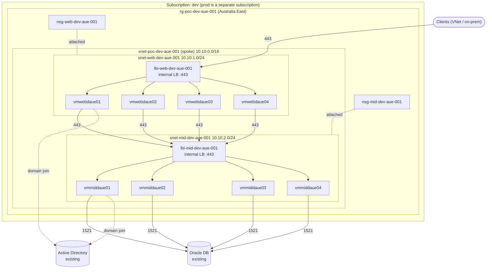
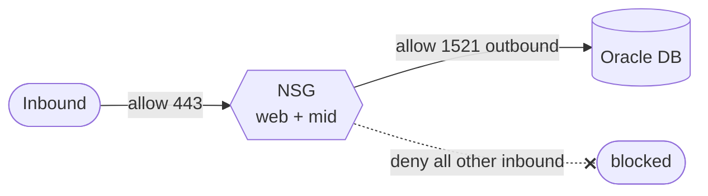
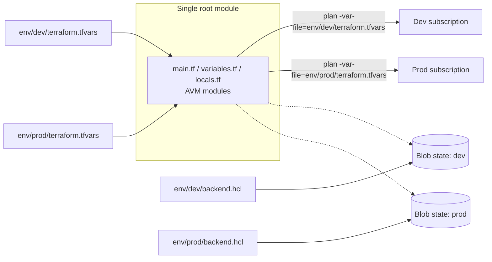

# Architecture Diagram

## Per-environment topology

The same code deploys dev and prod. Only the tfvars change. Names are shown for dev, and address ranges are example defaults.

## NSG rules

## Terraform layout and environments

